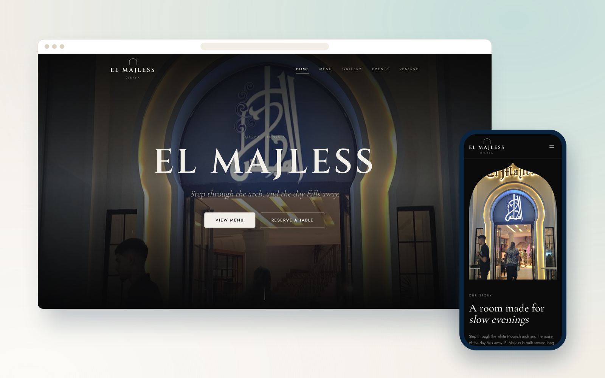
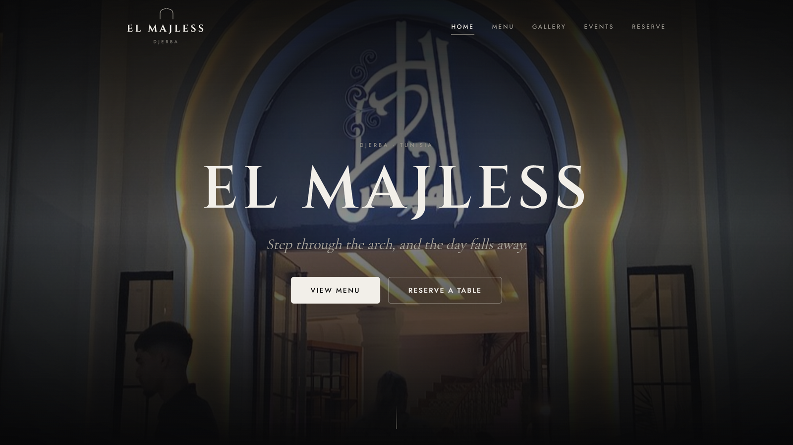
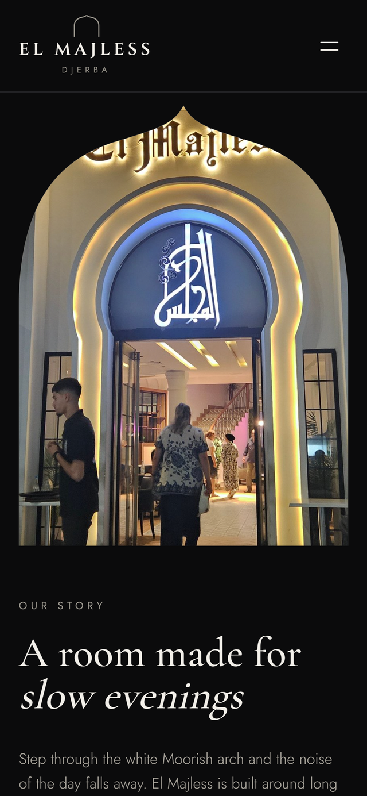
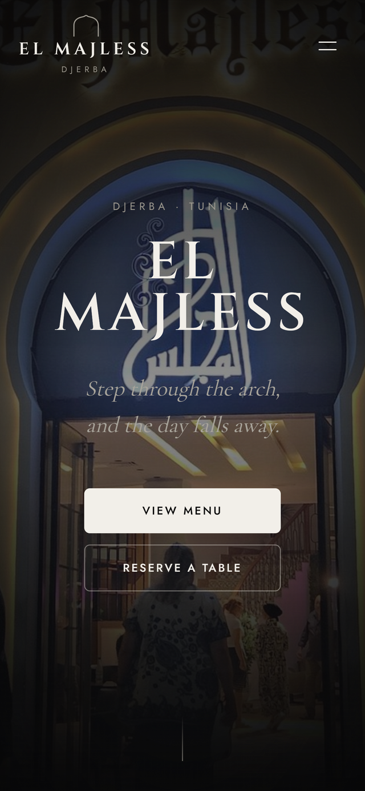
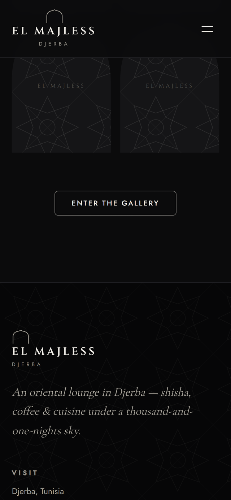

  

<h1 align="center">El Majless</h1>

  <b>Commande au restaurant par QR code, avec panneau de cuisine mis à jour en temps réel.</b>
   
  QR code ordering for a restaurant, with a kitchen panel updated in real time.

  
  

  
  
  

---

## Le projet

Le client scanne le QR code posé sur sa table, consulte le menu sur son téléphone et commande sans attendre le serveur. Chaque commande apparaît instantanément sur le panneau d'administration en cuisine grâce aux abonnements temps réel de Supabase, avec un suivi de statut de la prise de commande jusqu'au service.

## Fonctionnalités

- Menu digital accessible par QR code, sans installation d’application
- Commandes poussées en temps réel vers le panneau de cuisine
- Suivi de statut : reçue → en préparation → servie
- Gestion du menu, des catégories et des disponibilités par le restaurant
- Numéro de table transmis automatiquement avec la commande

## Aperçu

### Ordinateur

### Mobile

  
  
  

## Fiche

| | |
|---|---|
| **Type** | Système sur mesure |
| **Contexte** | Projet client · Restaurant El Majless |
| **Année** | 2025 |
| **Rôle** | Conception et développement complets (design, front-end, back-end, mise en ligne) |
| **Technologies** | React · Vite · Supabase Realtime |
| **Site** | [elmajless.vercel.app](https://elmajless.vercel.app) |

## Code source

> [!NOTE]
> Le code source de ce projet client est privé. Ce dépôt est une vitrine : il présente le projet, ses fonctionnalités et des captures.
> Pour en discuter ou pour un projet similaire : [portfolio](https://satouri-dev.vercel.app/fr) · [LinkedIn](https://www.linkedin.com/in/abdel-monaam-satouri-054268314).

---

  Conçu et développé par <a href="https://satouri-dev.vercel.app/fr">Satouri Développement</a> · Djerba, Tunisie
   
  © 2025 Abdelmonaam Satouri — Tous droits réservés

